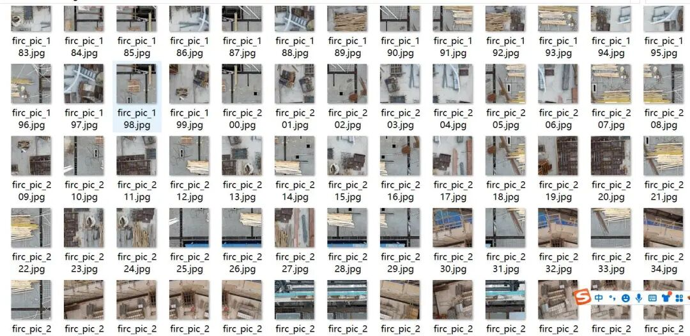
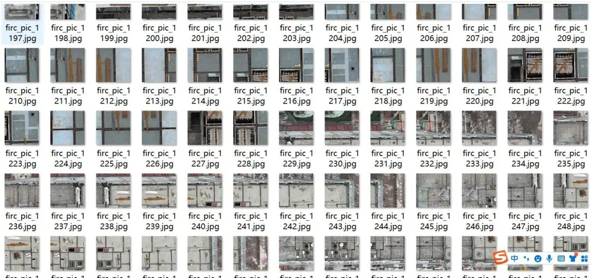
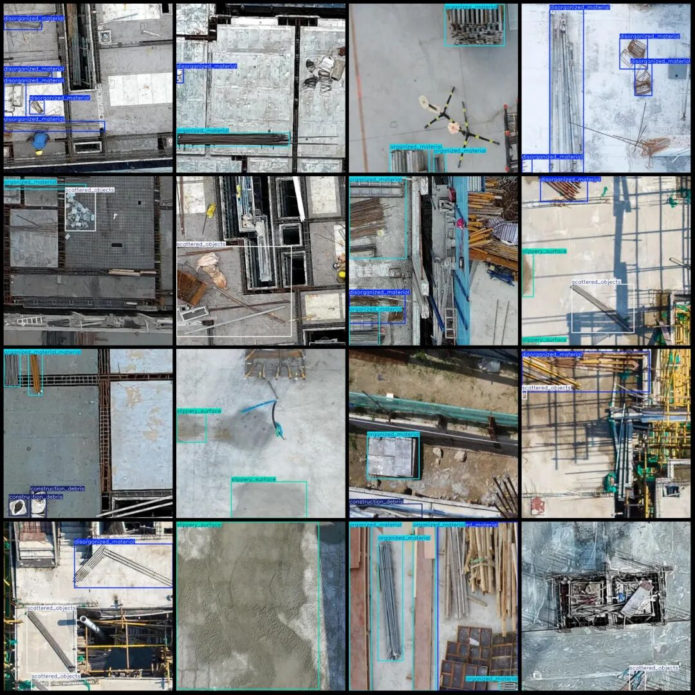
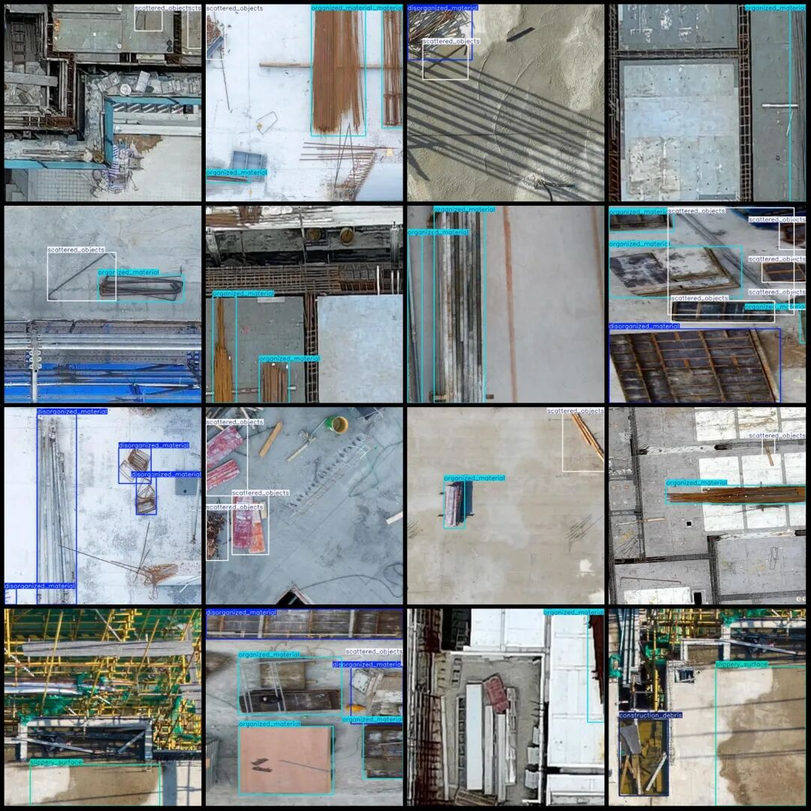

# UAV Perspective Aerial Photography of Construction Site Materials and Waste Detection Dataset in VOC+YOLO format with 2122 images across 5 categories

Dataset format: Pascal VOC format + YOLO format (txt file without split path, only contains jpg images and corresponding VOC format xml files and yolo format txt files)

Number of images (number of jpg files): 2122

Number of annotations (number of xml files): 2122

Number of annotations (number of txt files): 2122

Labeling category count: 5

Label category names (note that the order of categories in the YOLO format does not correspond to this, but is based on the labels folder's classes.txt): ["construction_debris", "disorganized_material", "organized_material", "scattered_objects", "slippery_surface"]

Number of boxes labeled in each category:

Construction debris (construction rubble) frame count = 640

disorganized_material (Materials are scattered haphazardly) Frame count = 2327

Organized Material (Materials neatly stacked) Boxes = 2312

scattered_objects (miscellaneous objects scattered) frame count = 4072

slippery_surface (ground is slippery) frame count = 480

Total frame count: 9831

Drone: DJI Mavic Pro

Collection height: 50-60m

Sampling angle: 90°

Image resolution: 640x640

Application Domain: Safety and environmental management inspections for construction sites or industrial premises.

Using labelImg:

Annotation rules: Draw a rectangle around the category.

Important Notice: No

Special : This dataset does not guarantee the accuracy of the trained models or weight files.

Image Preview:

Annotation example:

## Payment

Here is a pay link on Stripe ( https://buy.stripe.com/3cs8yP7sY87d0vu9AB ). Please contact me lonlonago@foxmail.com after funding $89, and I will send you a complete data files , thank you!

